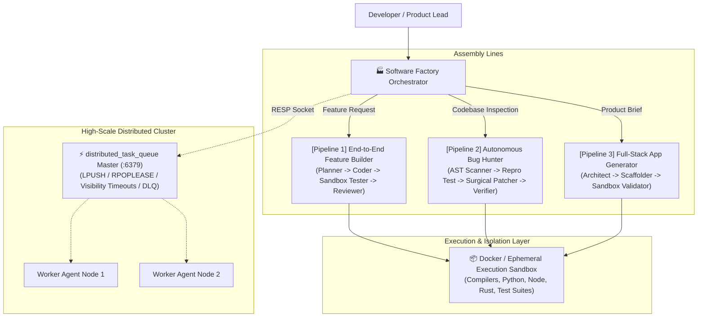

# 🏭 Agent Software Factory

**Lead Maintainer & Primary Contributor:** **Jordan Isaac (`dragpk247`)**  
*Autonomous AI Agent Multi-Pipeline Engineering System*

---

## ⚡ Executive Summary

The **Agent Software Factory** is an enterprise-grade autonomous engineering system designed to plan, develop, test, fix, and scaffold software systems through specialized multi-agent assembly lines. 

Built with strict sandboxing and modular agent orchestration, the factory can operate in **standalone mode** (local or Dockerized containers) and includes native integration hooks to scale across clusters using the high-performance **[`distributed_task_queue`](https://github.com/dragpk247/distributed_task_queue)** engine via RESP wire protocol.

---

## 🏛️ System Architecture



---

## 🚀 The 3 Specialized Assembly Lines

Each pipeline operates as an independent, decoupled assembly line with its own dedicated documentation:

### 1. [End-to-End Feature Builder](pipelines/1-feature-builder/README.md)
* **Objective:** Takes high-level features or issue descriptions and produces complete, tested code with Pull Request documentation.
* **Agents:** `FeaturePlannerAgent` ➔ `FeatureCoderAgent` ➔ `FeatureTesterAgent` ➔ `FeatureReviewerAgent`.
* **Execution:**
  ```bash
  python run_feature_builder.py --spec "Add moving average calculation with empty-list guard"
  ```
* **Read Guide:** 📖 [pipelines/1-feature-builder/README.md](pipelines/1-feature-builder/README.md)

---

### 2. [Autonomous Bug Hunter & Refactorer](pipelines/2-bug-hunter/README.md)
* **Objective:** Scans repositories for anomalies, vulnerabilities, and code smells, writes a failing reproduction test (TDD), synthesizes a surgical patch, and verifies zero regressions.
* **Agents:** `BugScannerAgent` ➔ `BugReproducerAgent` ➔ `BugPatcherAgent` ➔ `BugVerifierAgent`.
* **Execution:**
  ```bash
  python run_bug_hunter.py --workspace ./workspace
  ```
* **Read Guide:** 📖 [pipelines/2-bug-hunter/README.md](pipelines/2-bug-hunter/README.md)

---

### 3. [Full-Stack Microservice & App Generator](pipelines/3-app-generator/README.md)
* **Objective:** Transforms natural language product specs into complete, production-ready microservices with database schemas, OpenAPI contracts, and Docker packaging.
* **Agents:** `AppArchitectAgent` ➔ `AppScaffolderAgent` ➔ `AppValidatorAgent`.
* **Execution:**
  ```bash
  python run_app_generator.py --spec "REST API for inventory tracking with SQLite and Dockerfile"
  ```
* **Read Guide:** 📖 [pipelines/3-app-generator/README.md](pipelines/3-app-generator/README.md)

---

## 📦 Docker Sandbox Isolation

To guarantee that agent code generation and test execution cannot adversely impact the host machine, the factory provides a dedicated Dockerized execution sandbox equipped with compilers and test runners:

```bash
# Build the agent sandbox image
docker compose -f docker/docker-compose.yml build

# Start the ephemeral sandbox container
docker compose -f docker/docker-compose.yml up -d

# Execute any pipeline inside Docker
python run_feature_builder.py --docker
```

---

## ⚡ Integration with `distributed_task_queue`

The factory includes a pre-built RESP client adapter located in [`integration/dtq_worker.py`](integration/dtq_worker.py). 

When you run your **[`distributed_task_queue`](https://github.com/dragpk247/distributed_task_queue)** Rust engine:
```bash
cargo run -- --bind 127.0.0.1:6379
```

You can dispatch factory jobs across a fleet of remote agent workers using standard Redis wire protocol commands:
```python
from integration.dtq_worker import DistributedTaskQueueClient

client = DistributedTaskQueueClient(host="127.0.0.1", port=6379)
client.connect()

# Schedule feature generation onto the distributed queue
client.push_factory_job("factory_jobs", {
    "pipeline": "feature_builder",
    "spec": "Add exponential backoff retry mechanism"
})

# Workers lease jobs atomically with visibility timeouts
job = client.lease_factory_job("factory_jobs", visibility_secs=120)
```

---

## 👤 Maintainers & Contributors

* **Lead Maintainer:** Jordan Isaac ([@dragpk247](https://github.com/dragpk247))

---

## 📄 License

Licensed under the MIT License.
