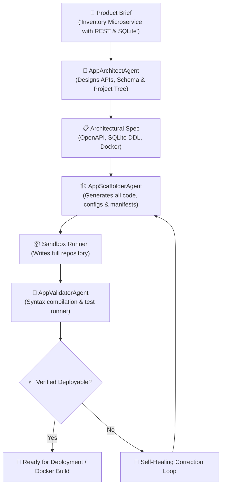

# 🚀 Pipeline 3: Autonomous Full-Stack App & Microservice Generator

**Lead Maintainer:** Jordan Isaac (`dragpk247`)

The **App Generator Assembly Line** converts high-level product briefs into complete, deployable microservice and full-stack software repositories. It designs OpenAPI REST specs, SQL database schemas, scaffolds clean modular project structures, and verifies code compilation and smoke tests inside isolated sandboxes.

---

## 🏛️ Pipeline Architecture & Workflow



---

## 🧩 Agent Roles

| Agent | Module | Primary Responsibility |
| :--- | :--- | :--- |
| **`AppArchitectAgent`** | `architect.py` | Produces database schemas, endpoint routing, and tech stack configurations from natural language. |
| **`AppScaffolderAgent`** | `scaffolder.py` | Generates runnable boilerplate, FastAPI apps, Dockerfiles, and test harnesses. |
| **`AppValidatorAgent`** | `validator.py` | Verifies syntax compilation, executes test discovery, and validates containerization. |

---

## 🚀 Running the Pipeline

### Direct Execution
```bash
python run_app_generator.py --spec "REST API for tracking IoT sensor readings with SQLite and healthcheck"
```

### Programmatic Integration
```python
from pipelines.app_generator.architect import AppArchitectAgent
from pipelines.app_generator.scaffolder import AppScaffolderAgent
from pipelines.app_generator.validator import AppValidatorAgent
from core.sandbox import ExecutionSandbox
from core.llm_provider import LLMProvider

sandbox = ExecutionSandbox(local_workspace="./workspace/generated_app")
llm = LLMProvider()

# 1. Architect system
spec = AppArchitectAgent(llm).design_architecture("Real-time order checkout service")

# 2. Scaffold files
files = AppScaffolderAgent(llm).scaffold_application(spec)
for rel_path, code in files.items():
    sandbox.write_file(rel_path, code)

# 3. Validate
result = AppValidatorAgent(sandbox).validate_scaffold()
print(f"App Generated & Validated: {result['valid']}")
```
