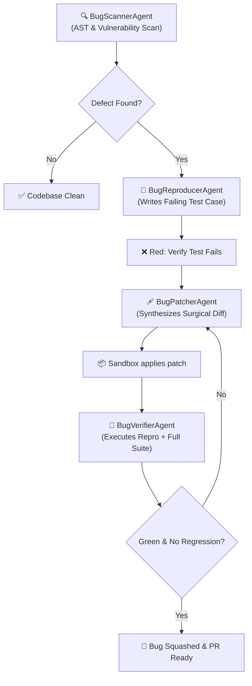

# 🛡️ Pipeline 2: Autonomous Bug Hunter & Refactorer

**Lead Maintainer:** Jordan Isaac (`dragpk247`)

The **Bug Hunter Assembly Line** provides continuous codebase hygiene, proactive defect discovery, and test-driven automated patching. It implements an autonomous TDD (Test-Driven Development) loop: finding anomalies, generating a failing reproduction test, crafting a surgical fix, and verifying zero regressions.

---

## 🏛️ Pipeline Architecture & Workflow



---

## 🧩 Agent Roles

| Agent | Module | Primary Responsibility |
| :--- | :--- | :--- |
| **`BugScannerAgent`** | `scanner.py` | AST traversal, unchecked division checks, unhandled exceptions, and pattern matching. |
| **`BugReproducerAgent`** | `reproducer.py` | Writes a clean, standalone unit test that triggers the bug consistently. |
| **`BugPatcherAgent`** | `patcher.py` | Analyzes AST tracebacks and generates targeted, minimal code modifications. |
| **`BugVerifierAgent`** | `verifier.py` | Asserts that the new test passes and confirms 100% of existing tests remain unaffected. |

---

## 🚀 Running the Pipeline

### Direct Execution
```bash
python run_bug_hunter.py --target-dir ./workspace
```

### Programmatic Integration
```python
from pipelines.bug_hunter.scanner import BugScannerAgent
from pipelines.bug_hunter.reproducer import BugReproducerAgent
from pipelines.bug_hunter.patcher import BugPatcherAgent
from pipelines.bug_hunter.verifier import BugVerifierAgent
from core.sandbox import ExecutionSandbox
from core.llm_provider import LLMProvider

sandbox = ExecutionSandbox()
llm = LLMProvider()

# 1. Scan for smells & bugs
findings = BugScannerAgent(workspace_path="./workspace").scan_codebase()

# 2. For each finding, trigger the TDD healing loop
for finding in findings:
    source = sandbox.read_file(finding["file"])
    repro_test = BugReproducerAgent(llm).generate_failing_test(finding, source)
    sandbox.write_file("tests/test_repro.py", repro_test)
    
    patch = BugPatcherAgent(llm).generate_patch(finding, source, repro_test)
    sandbox.write_file(finding["file"], patch)
    
    results = BugVerifierAgent(sandbox).verify_patch("python -m unittest tests/test_repro.py", "python -m unittest discover tests")
    print(f"Verified fix for {finding['file']}: {results['verified']}")
```
