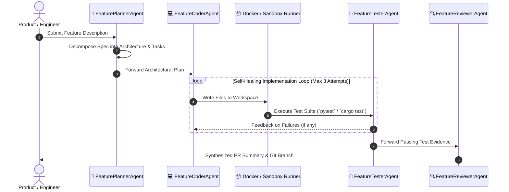

# 🏭 Pipeline 1: Autonomous End-to-End Feature Builder

**Lead Maintainer:** Jordan Isaac (`dragpk247`)

The **Feature Builder Assembly Line** converts product feature requests, user stories, or GitHub issue specifications into verified, production-ready code complete with automated test suites, regression verification, and ready-to-merge Pull Request summaries.

---

## 🏛️ Pipeline Architecture & Workflow



---

## 🧩 Agent Roles

| Agent | Module | Primary Responsibility |
| :--- | :--- | :--- |
| **`FeaturePlannerAgent`** | `planner.py` | Analyzes existing repo context, defines modules, schemas, and step-by-step task breakdown. |
| **`FeatureCoderAgent`** | `coder.py` | Generates idiomatic code, typed interfaces, and unit tests adhering to the architecture. |
| **`FeatureTesterAgent`** | `tester.py` | Runs tests inside the sandboxed environment and extracts compiler/test failure logs. |
| **`FeatureReviewerAgent`** | `reviewer.py` | Evaluates test passes, checks security practices, and writes comprehensive PR documentation. |

---

## 🚀 Running the Pipeline

### Direct Execution
```bash
python run_feature_builder.py --spec "Add moving average calculation with empty-list guard"
```

### Programmatic Integration
```python
from core.sandbox import ExecutionSandbox
from core.llm_provider import LLMProvider
from pipelines.feature_builder.planner import FeaturePlannerAgent
from pipelines.feature_builder.coder import FeatureCoderAgent
from pipelines.feature_builder.tester import FeatureTesterAgent
from pipelines.feature_builder.reviewer import FeatureReviewerAgent

sandbox = ExecutionSandbox(local_workspace="./workspace")
llm = LLMProvider()

plan = FeaturePlannerAgent(llm).plan_feature("Add user rate limiter")
files = FeatureCoderAgent(llm).generate_code(plan)

for path, content in files.items():
    sandbox.write_file(path, content)

results = FeatureTesterAgent(sandbox).run_tests()
pr = FeatureReviewerAgent(llm).generate_pr_summary(plan, files, results)
print(pr)
```
